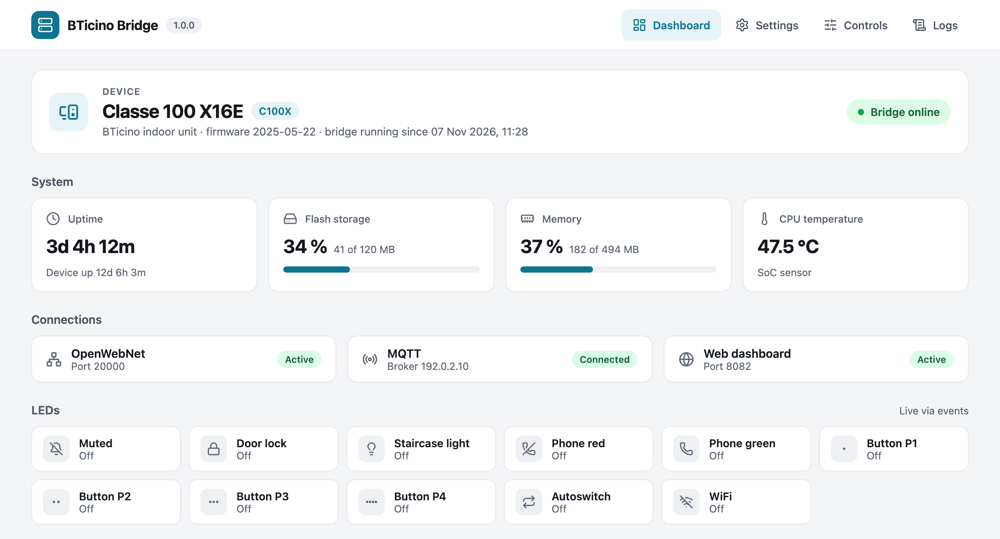
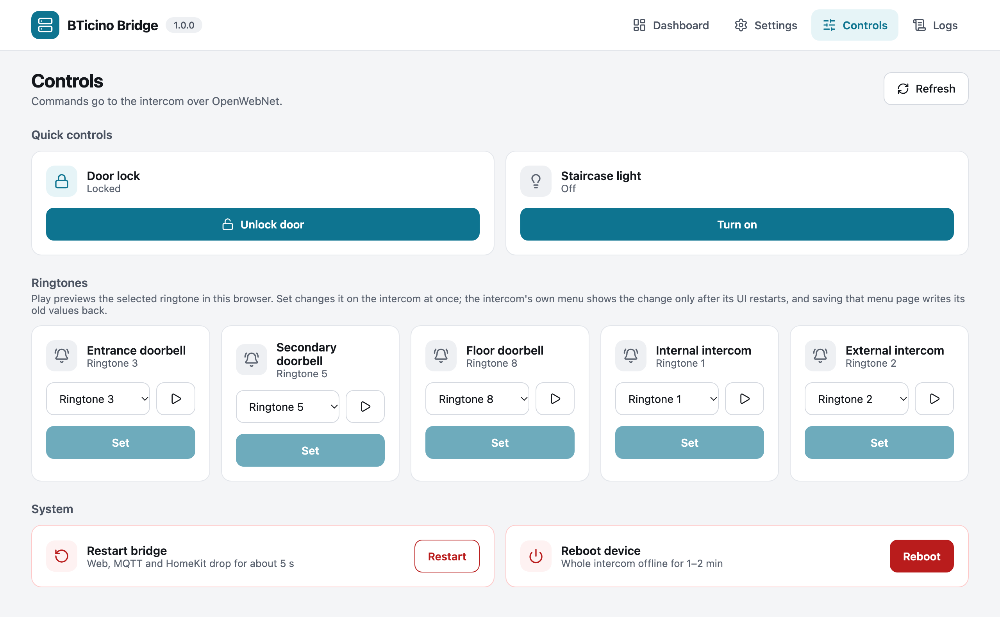

# BTicino Classe 100X / 300X — rooted firmware and Home Assistant bridge

Run a BTicino Classe 100X or 300X video door entry unit with
[Home Assistant](https://www.home-assistant.io/), without the official cloud
app. The project builds a rooted firmware image from the official firmware you
already own and adds `bticino_bridge`, which exposes the unit over MQTT (with
Home Assistant auto-discovery), HomeKit, a web dashboard and RTSP video.

## About this fork

This repository is a fork of
[fquinto/bticinoClasse300x](https://github.com/fquinto/bticinoClasse300x).
Changes from upstream are merged into it. The fork adds its own work on the
bridge: a redesigned web UI, security and shutdown fixes, English entity names,
and an SSH watchdog in the firmware. It is tested on a Classe 100X; the Classe
300X features are not tested here.

## Getting started

1. Build the firmware with `legacy/main.py` and flash it with MyHOME Suite, see
   [`legacy/README.md`](legacy/README.md).
2. Deploy the bridge (needs Go 1.25+ and Node.js on the build machine):
   ```bash
   cd bticino_bridge
   make deploy
   ```
3. Open the dashboard at `http://<device-ip>:8082` and set up MQTT on the
   Settings page.





Changes: [`bticino_bridge/CHANGELOG.md`](bticino_bridge/CHANGELOG.md).

## Model status

| Model | Bridge in Home Assistant | Status |
|---|---|---|
| Classe 100X | yes | tested in this fork |
| Classe 300X | yes | from upstream, not tested in this fork |

The device variant is set when the bridge is built, see
[`bticino_bridge/README.md`](bticino_bridge/README.md). The firmware builder
in `legacy/` comes from upstream and was not tested end to end in this fork.

## What is in this repository

| Path | What it is |
|---|---|
| [`bticino_bridge/`](bticino_bridge/README.md) | The bridge: MQTT, HomeKit, web dashboard, REST API, RTSP video |
| [`legacy/`](legacy/README.md) | Firmware builder (`main.py`) and the MyHOME Suite flashing steps |
| `firmware_scripts/` | `bt_ssh_guard`, the SSH watchdog built into the firmware |
| [`docs/`](docs/README.md) | Guides and the OpenWebNet command reference |
| [`hashes/`](hashes/README.md) | Checksums of official firmware (no firmware itself) |
| [`mqtt_scripts/`](mqtt_scripts/README.md) | MQTT scripts for use without the bridge |
| [`sip/`](sip/README.md) | Notes on SIP calls to the unit |

## Device integration reference

- [OpenWebNet commands](docs/openwebnet-commands.md): the known commands and
  notifications, and how to find new ones.
- [`mqtt_scripts/`](mqtt_scripts/README.md): the manual integration path,
  without the bridge.

## Related projects

- [`intercom-firmware-tool`](https://github.com/jorgeavlobo/intercom-firmware-tool)
  by jorgeavlobo: a firmware tool with a Windows-friendly flow.
- [`bticino-classe100x-ha`](https://github.com/jorgeavlobo/bticino-classe100x-ha)
  by jorgeavlobo: a lighter Classe 100X ↔ Home Assistant integration.

## Safety and license

You bring your own firmware; this project does not host or redistribute BTicino
images ([`docs/bring-your-own-firmware.md`](docs/bring-your-own-firmware.md)).
Flashing can brick the unit; read [`THREAT_MODEL.md`](THREAT_MODEL.md) first.
How the project was built without proprietary code or firmware:
[`CLEANROOM.md`](CLEANROOM.md). Security issues: [`SECURITY.md`](SECURITY.md).
Licensed under the GNU GPL v2 ([`LICENSE`](LICENSE)).
